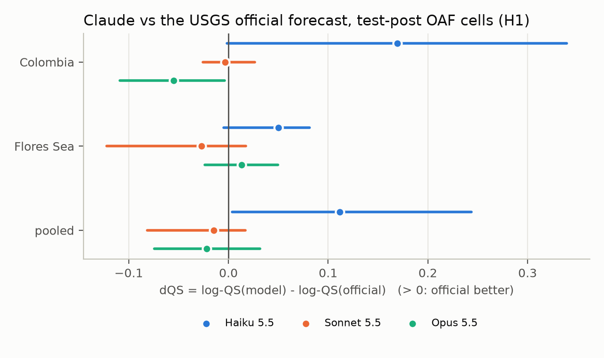
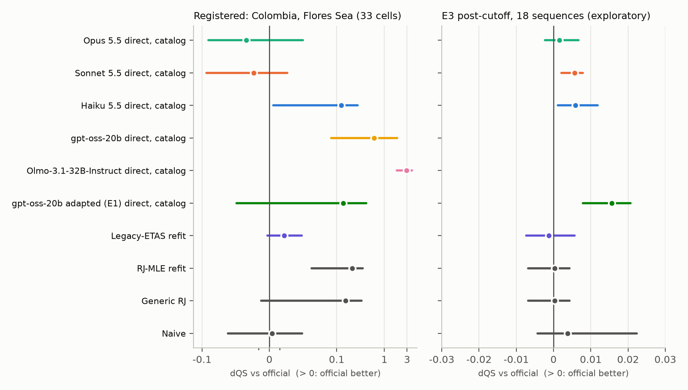

# Do LLMs forecast aftershocks like the USGS? A contamination-aware benchmark

Tyler Newton (solo). CRediT: conceptualization, data curation, software, formal analysis,
visualization, writing (T. Newton).

## Introduction

After a large earthquake, people ask chatbots how many more shocks to expect and how big they
might be. The US Geological Survey answers the same question with operational aftershock
forecasts (OAF), issued for US earthquakes since 2018 and for some large earthquakes abroad and
revised as each sequence unfolds; a prospective evaluation in Puerto Rico found its ETAS-based
forecast performed well. We asked whether
general-purpose language models, given exactly the information USGS had at each issue time,
forecast aftershock counts as well as the official product, and scored both with proper scoring
rules on sequences that began after the models' training cutoff.

## Results

We built every forecast question from ComCat and the archived OAF versions of eleven M≥7
sequences (July 2025 to October 2026): 61 issue times, each with 1-day, 1-week and 1-month
windows, and a prompt catalog rebuilt as ComCat stood at the issue time from its product
histories (the rebuild reproduces 95.1% of the official products' own observation counts).
Claude Haiku, Sonnet and Opus 5.5 answered 3,710 structured requests, either directly as nine
quantiles of the M≥5 count or as Reasenberg-Jones parameters, with and without the catalog. We
scored them against the observed counts with the log-scale quantile score (how far the forecast
range falls from what happened, on a log scale; lower is better), beside the official
forecast, a port of the USGS legacy-ETAS code refit at each issue time, and simpler baselines.
The hypotheses, cells and analysis were preregistered and frozen (tag `prereg-v1`, SHA-256
posted publicly) before any scored call, and the scoring code was frozen (`scoring-v1`) before
any result was read.

On the 33 settled cells (sequence × issue time × window) of the post-cutoff sequences that have
an official forecast (Colombia and Flores Sea), Sonnet and Opus could not be distinguished from
USGS at this scale: the pooled score difference to the official forecast (negative favours the
model) is −0.015 (95% interval from resampling blocks of issue times, −0.081 to 0.017)
for Sonnet and −0.022 (−0.074 to 0.032) for Opus, with signs that differ between the two
sequences, while Haiku is worse than the official forecast (+0.124, 0.004 to 0.278, or +0.048
counting only its valid answers; Figure 1).
Across all 132 primary cells the official forecast's central intervals are wide (50% intervals
cover 76% of outcomes, 90% intervals 92%); Sonnet's are closest to nominal at the 50% level (70%
and 92%), and Opus and Haiku are slightly narrow at 90% (87% and 85%). Asking for model
parameters instead of quantiles made every model worse (pooled differences +0.02 to +0.08), and
showing the catalog helped Sonnet (−0.042, −0.124 to −0.020) but not consistently the others.
Claude's outputs were almost always usable: at most 2.7% of samples per model and arm were
invalid (non-monotone quantiles), with no refusals and no truncations. Two open-weight models
run locally were far behind the official forecast even counting only valid answers (+0.24 for
gpt-oss-20b, +0.17 for Olmo 3.1 32B), and 12% and 54% of their quantile answers were invalid.
Fine-tuning gpt-oss-20b on legacy-ETAS forecasts for 515 earlier sequences (Adaption
AutoScientist, LoRA) made every answer valid, but the adapted model still trailed the ETAS refit
it imitated (+0.20, 0.03 to 0.40) and the official forecast (+0.14, −0.03 to 0.42). A fixed literature search
(Valency) found 23 papers about four of the eleven mainshocks, none available before any issue
time; only Kamchatka had papers dated before the Claude cutoff (12 of 18). Live forecasts for the ongoing
Panama sequence were hashed and published 46 minutes before their windows opened and will be
scored once the catalog settles. These are pilot-scale results: the headline rests on two
sequences, and per-sequence estimates, not significance tests, carry the claims.

*Figure 1. Score difference between each Claude model (direct quantiles, with the catalog) and
the USGS official forecast on settled post-cutoff cells; positive values favour USGS. Bars are
95% moving-block bootstrap intervals.*

**Exploratory extensions** (added after the freeze; docs/deviations.md). To test the headline
at scale we scored 39 more sequences that have an official forecast (M≥5, mostly Alaska, the
Marianas and the US West Coast; 18 after the Claude cutoff, 21 before), with the frozen code:
536 settled cells. Most windows saw no M≥5 aftershock, so differences are small. On the
post-cutoff cells Opus again matched USGS (+0.002, −0.002 to 0.007; for M≥4 counts −0.000,
−0.032 to 0.016), Sonnet and Haiku were slightly worse (+0.006 and +0.012), and Sonnet without
the catalog was clearly worse for M≥4 counts (+0.13, 0.07 to 0.20). Claude did no better on
the pre-cutoff sequences than the ETAS refit's own shift between the two sets, and the two open
models, whose cutoffs predate both sets, kept similar gaps after and before (gpt-oss +0.08 and
+0.07, Olmo +0.21 and +0.23): no sign of contamination. Averaging Claude's quantiles with the official ones did not reliably improve
on USGS (Opus, registered cells: −0.013, −0.030 to 0.004). Repeated adaptation runs showed
that most differences between adapted models are run-to-run noise: three runs on the original
data trailed USGS on the registered cells by +0.14 to +0.25, and two runs on three times the
data (1,505 sequences from M6.0) by +0.19 and +0.23; on the extended set the larger training
set came slightly closer to USGS (M≥5: +0.000 and +0.005, against +0.006 to +0.016). A second live Panama round was
hashed before its windows opened (tag `live-panama-2`).

*Figure 2. Every forecaster against the official forecast, registered cells (left, symmetric
log scale) and the exploratory post-cutoff set (right).*

## Future work

The benchmark grows prospectively with every new forecast-bearing sequence, which will turn the
pilot into a test with real power; we will add tool-using models and test adaptation that learns
from observed aftershock counts rather than from ETAS forecasts.

## Open-source materials

Code, data, prompts, preregistration and all model outputs:
https://github.com/tjnewton/llm-aftershock-forecast (tags `prereg-v1`, `scoring-v1`,
`live-panama-1`, `live-panama-2`). Interactive results explorer (marimo, runs in the browser; loads in
about 15 s): https://tjnewton.github.io/llm-aftershock-forecast/; frozen analysis notebook, rendered:
`results/analysis.html`. Adapted models: Adaption AutoScientist. Literature search and citation
checks: Valency MCP Bond. Video: [VIDEO LINK].

## References

1. Reasenberg, P. A. & Jones, L. M. (1989). Earthquake hazard after a mainshock in California.
   *Science* 243, 1173-1176. https://doi.org/10.1126/science.243.4895.1173
2. Hardebeck, J. L. et al. (2024). Aftershock forecasting. *Annu. Rev. Earth Planet. Sci.* 52,
   61-84. https://doi.org/10.1146/annurev-earth-040522-102129
3. van der Elst, N. J. et al. (2022). Prospective and retrospective evaluation of the U.S.
   Geological Survey public aftershock forecast for the 2019-2021 Southwest Puerto Rico
   earthquake and aftershocks. *Seismol. Res. Lett.* 93, 620-640.
   https://doi.org/10.1785/0220210222
4. Bosse, N. I. et al. (2023). Scoring epidemiological forecasts on transformed scales. *PLoS
   Comput. Biol.* 19, e1011393. https://doi.org/10.1371/journal.pcbi.1011393
5. Karger, E. et al. (2025). ForecastBench: a dynamic benchmark of AI forecasting capabilities.
   ICLR 2025. https://arxiv.org/abs/2409.19839
6. Zhu, W. (2026). Earthquake aftershock forecasting using conditional generative models
   (QuakeGen). https://arxiv.org/abs/2607.24109
