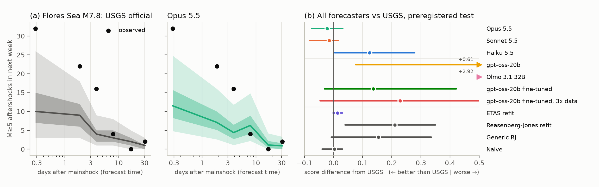

# Do LLMs forecast aftershocks like the USGS? A contamination-aware benchmark

Tyler Newton (solo). CRediT: conceptualization, data curation, software, formal analysis,
visualization, writing (T. Newton).

## Introduction

After a large earthquake, people ask chatbots how many more shocks to expect. The US Geological
Survey (USGS) answers the same question with operational aftershock forecasts [2, 3]. We asked
whether general-purpose language models, given exactly what USGS knew at each forecast time,
forecast as well, on earthquakes that began after the models' training cutoff, so the answers
cannot have been memorized [5].

## Results

We built forecast questions from the ComCat catalog and the archived official forecasts of eleven
M≥7 sequences (July 2025 to October 2026): 61 forecast times, each asking for the number of M≥5
aftershocks in the next day, week and month. Each prompt held only the catalog as it stood at
that time, rebuilt from ComCat's revision histories (it reproduces 95.1% of the official
forecasts' own counts). Claude Haiku, Sonnet and Opus 5.5 answered 3,710 requests with nine
quantiles or with Reasenberg-Jones parameters [1], with and without the catalog. We scored them
with the log-scale quantile score [4] beside the official forecast, a refit of the USGS ETAS
model and simpler baselines. Hypotheses and analysis were frozen and their SHA-256 posted
publicly before any scored call (tag `prereg-v1`).

On the 33 settled windows of the two post-cutoff sequences with an official forecast (Colombia
and Flores Sea), Opus and Sonnet could not be distinguished from USGS (score difference −0.022,
95% interval −0.074 to 0.032, and −0.015, −0.081 to 0.017; negative favours the model), while
Haiku was worse (+0.124, 0.004 to 0.278; Figure 1b). Two sequences cannot separate this top
tier: the ETAS refit and even a naive baseline also tie USGS. The benchmark does separate weaker
forecasters. Two open models run locally, gpt-oss-20b and Olmo 3.1 32B, were far behind, with
12% and 54% of answers unusable against at most 2.7% for Claude; fine-tuning gpt-oss-20b on ETAS
forecasts for 515 earlier sequences (Adaption) made every answer usable but still trailed USGS
(+0.14). Asking for model parameters instead of quantiles made every model worse, and showing
the catalog helped. USGS and Opus both under-predicted the early Flores Sea aftershocks
(Figure 1a).

*Figure 1. (a) Forecasts of the number of M≥5 aftershocks in the next week after the M7.8 Flores
Sea earthquake, by USGS and Opus 5.5 (bands: 50% and 90% ranges; dots: observed). (b) Mean
score difference from the USGS forecast on the 33 preregistered windows, with 95% moving-block
bootstrap intervals; left of zero favours the forecaster.*

After the freeze we scored 39 more sequences with an official forecast (M≥5, 18 after the Claude
cutoff) with the frozen code (exploratory). Opus again matched USGS (+0.002, −0.002 to 0.007),
and Sonnet without the catalog was clearly worse for M≥4 counts (+0.13). Claude did no better before its cutoff than after, and the open
models, trained before both sets, kept the same gap on both: no sign of memorization. A fixed
literature search (Valency) found no paper on any mainshock before its forecasts.
Live forecasts for the ongoing Panama sequence were hashed and published before their windows
opened.

## Future work

These are pilot-scale results. The benchmark grows with every new forecast-bearing sequence,
which will give it the power to separate the top tier; next we will add tool-using models.

## Open-source materials

Code, data, prompts, preregistration and every model output (tags `prereg-v1`, `scoring-v1`,
`live-panama-1`, `live-panama-2`): https://github.com/tjnewton/llm-aftershock-forecast.
Interactive explorer (marimo): https://tjnewton.github.io/llm-aftershock-forecast/.
Video: [VIDEO LINK].

## References

1. Reasenberg, P. A. & Jones, L. M. (1989). Earthquake hazard after a mainshock in California.
   *Science* 243, 1173-1176. doi:10.1126/science.243.4895.1173
2. Hardebeck, J. L. et al. (2024). Aftershock forecasting. *Annu. Rev. Earth Planet. Sci.* 52,
   61-84. doi:10.1146/annurev-earth-040522-102129
3. van der Elst, N. J. et al. (2022). Prospective and retrospective evaluation of the U.S.
   Geological Survey public aftershock forecast for the 2019-2021 Southwest Puerto Rico
   earthquake and aftershocks. *Seismol. Res. Lett.* 93, 620-640.
   doi:10.1785/0220210222
4. Bosse, N. I. et al. (2023). Scoring epidemiological forecasts on transformed scales. *PLoS
   Comput. Biol.* 19, e1011393. doi:10.1371/journal.pcbi.1011393
5. Karger, E. et al. (2025). ForecastBench: a dynamic benchmark of AI forecasting capabilities.
   ICLR 2025. https://arxiv.org/abs/2409.19839
